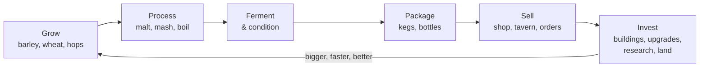
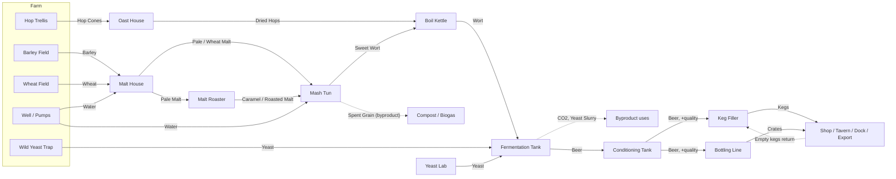
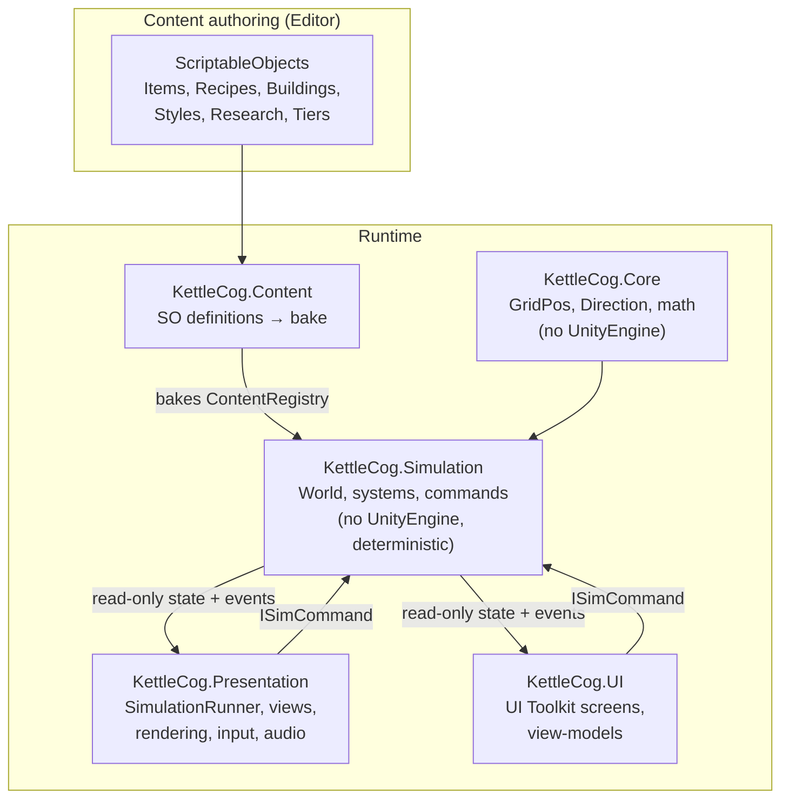

# Kettle & Cog — Game Design Document

> *Grow it. Brew it. Automate it. Cheers!*

| | |
|---|---|
| **Document** | Concept GDD v0.1 |
| **Genre** | Cozy factory-builder / automation sim |
| **View** | Top-down ¾ perspective ("RPG view"), 2D pixel art, 16×16 px tiles |
| **Engine** | Unity 6 LTS, URP 2D Renderer |
| **Platforms** | PC/Mac (Steam) first, Steam Deck Verified; Switch-class consoles as a stretch goal |
| **Comparables** | Factorio, Satisfactory, shapez, Stardew Valley, Dyson Sphere Program |
| **Scope (1.0)** | 6 tiers, ~70 buildings, 18 beer styles, 40–60 h to the main goal, open-ended post-game |

## Contents

1. [Name](#1-name)
2. [Overview](#2-overview)
3. [Architecture](#3-architecture)
4. [Buildings](#4-buildings)
5. [Progression](#5-progression)
6. [Engagement Mechanics](#6-engagement-mechanics)
7. Appendices: [A Items](#appendix-a--item-catalogue) · [B Ratios](#appendix-b--ratio-cheat-sheet) · [C Assets](#appendix-c--art--audio-asset-budget) · [D Roadmap](#appendix-d--development-roadmap) · [E Risks](#appendix-e--risks--mitigations)

---

## 1. Name

### Kettle & Cog

- **Kettle**: the heart of every brewery. It stands for craft, warmth and the glow of copper.
- **Cog**: the factory game. It stands for machines, automation and optimisation.
- The ampersand promises both halves: a warm craft game *and* a satisfying machine to perfect.
- The name is short and easy to say in English and German. It also makes a clear logo: a hammered copper brew kettle with a cog for a lid, its steam curling into a hop cone.
- **Store capsule:** dusk over a timber-and-copper brewery with glowing windows. Kegs ride a conveyor past a hop yard full of fireflies, and the brewery cat sleeps on a warm kettle.
- **Taglines:** "Grow it. Brew it. Automate it. Cheers!" / "The coziest factory in the valley."

| Alternative names (backup) | Note |
|---|---|
| Hoptimize! | Pun on factory optimisation; very catchy, may collide with existing beer brands |
| Malt & Machine | Same two-halves idea as the main name |
| Pint-Sized Industries | Cute, signals cozy scale |
| Brewline Valley | Descriptive, less memorable |

> Before committing, run a trademark search and check Steam, itch.io and the console stores for the name.

---

## 2. Overview

### 2.1 Elevator pitch

You inherit your great-aunt Hilde's dusty little brewery in **Bramblebrook Valley**. At first you do everything by hand. You till a few rows of barley, pick hop cones and brew a cloudy farmhouse ale in a single copper kettle, then sell it from a wooden farm stand.

Every coin goes back into the brewery: a malt house, conveyor belts, fermentation tanks, a bottling line, steam power and finally a railway to the harbour. Hours later the whole valley hums with a fully automated brewery that turns sunshine and rain into 18 styles of award-winning beer. You still know where every hop cone came from.

### 2.2 Target audience

- **Primary:** automation fans (Factorio, Satisfactory, shapez) who want a warmer, lower-stress game: no biters, no pollution attacks, no game over.
- **Secondary:** cozy and farming players (Stardew Valley, Dinkum) who are ready for deeper systems. The game gently teaches ratios, belts and logistics.
- **Rating target:** PEGI 12 / ESRB T ("Alcohol Reference"). Beer is crafted and sold; nobody is ever shown drinking to excess (see [Appendix E](#appendix-e--risks--mitigations)).

### 2.3 Design pillars

1. **Cozy, never punishing.** There are no enemies, no fail state and no spoilage that destroys work. Bottlenecks slow you down; they never punish you. Seasons and weather add planning, not threat.
2. **Every pint is visible.** Every grain, hop cone, keg and bottle physically travels on belts and pipes, so players debug the factory by looking at it.
3. **From hands to machines.** Everything you do by hand early on (harvesting, carrying, filling kegs) gets automated later. The automation itself is the reward.
4. **Craft, not just throughput.** Quality stars, water profiles, yeast strains and style discovery give each production line a *recipe* dimension that pure factory games lack.
5. **Always one more batch.** A 30-second goal, a 10-minute goal and a 2-hour goal are always on screen.

### 2.4 Setting & tone

- **Bramblebrook Valley:** rolling meadows, a river with a creaky water wheel and a village with a tavern, *The Sleepy Badger*. Pine hills lie to the north, orchards to the east and a small harbour town to the south.
- **Technology arc:** a timber-and-copper farmhouse brewery (around 1890), then clockwork and water power, then steam, then "cozy-industrial" brass, narrow-gauge rail and clockwork bee drones. It never turns grim; even the smoke is fluffy and white.
- **Narrative:** light and told mostly through letters. Hilde's brewing journal is the tutorial voice. The *Brewers' Guild of the Five Valleys* sets the milestones, and villagers send requests and become regulars. The finale is the Grand Harvest Festival and the *Golden Tap*.
- **Mascot:** Hopscotch, the brewery cat. She naps on whichever kettle is warmest and can be petted. She has no gameplay function, which is the point.
- **Palette:** warm copper, honey, hop green and barn red. Nights are deep blue with glowing windows.

### 2.5 Core gameplay loop



The core loop runs at three nested time scales:

| Loop | Length | What the player does | Reward |
|---|---|---|---|
| **Moment** | 5–60 s | Place belts, connect pipes, hand-harvest, watch a batch finish | Animations, sounds, coins flying to the wallet |
| **Session** | 5–30 min | Spot a bottleneck, expand, fulfil an order or milestone | New building or recipe, money milestone, villager reaction |
| **Meta** | 2–10 h | Reach the next tier, open a region, discover styles, master quality | New mechanics, new map area, story beat |

**A typical 10-minute stretch in Tier 2:**

1. The Tavern's evening order needs 6 kegs of Amber Ale. The Ledger shows only 4 per hour.
2. The Bottleneck Lens turns the Malt Roaster yellow (input starved). The Malt House upstream is fine, but the belt splitter sends too much Pale Malt to the Mash Tuns.
3. The player adds a Sorter, builds a second Malt Roaster and runs a new belt. The Roaster lights up green and Amber wort flows.
4. While the fermenters work, the player designs a bottle label and queues *Cold Fermentation* in the Tasting Room.
5. At dusk the Shipping Dock settles the day's sales. The Daily Ledger shows a new income record, and the Guild Charter bar fills to 80 %. One more batch.

### 2.6 Production chain



**Side chains** (they join the main line at different tiers):

- **Wood:** Forester's Hut → Logs → Sawmill → Planks → Cooperage (kegs, barrels) and Workshop (crates, frames).
- **Copper:** Copper Mine → Ore → Smelter → Copper Sheets → Workshop (gears, pipes, coils), Boil Kettles, tanks.
- **Glass:** Sand Pit → Sand → Glassworks → Bottles.
- **Labels:** the Hop Trellis byproduct *Bine Fiber* → Label Press → Labels.
- **Cold:** Ice Cutter (winter) → Ice Blocks → Ice House → Cold zone for lagering. Later replaced by the Refrigeration Plant.
- **Byproducts:** Spent Grain → Compost (fertilizer) / Pellet Mill (fuel) / Biogas. Yeast Slurry → Yeast Lab / Biogas. CO₂ → Bottling Line.

**Byproduct rule (cozy):** a byproduct output never blocks a machine. When a byproduct slot is full, the extra is discarded with a small puff and a one-time hint that it could be put to use. Players are invited to close loops, never forced to.

### 2.7 Beer styles & style discovery

A beer style is determined by **wort family × yeast strain**, plus an optional **modifier** added during conditioning. This keeps the item count manageable (4 worts instead of 18) and turns style discovery into a small experimentation game.

**Style matrix (fermentation result):**

| Wort ↓ / Yeast → | Wild (Valley) | Ale | Weizen | Lager | Brett (Orchard) | Monastery |
|---|---|---|---|---|---|---|
| **Pale** | Farmhouse Ale | Pale Ale | *Experimental* | Pilsner | Brett Pale | Tripel |
| **Wheat** | Farmhouse Wheat | *Experimental* | Hefeweizen | *Experimental* | Sour Wheat | Witbier |
| **Amber** | *Experimental* | Amber Ale | *Experimental* | Märzen | *Experimental* | Dubbel |
| **Dark** | *Experimental* | Stout | Dunkelweizen | Schwarzbier | *Experimental* | *Experimental* |

*Experimental Brew* is always sellable at a low price. Every attempt adds a hint to the Beer Codex ("Old Gus says dark malt and wheat yeast make something lovely...").

**Modifiers (Conditioning Tank or Unitank):**

| Base beer | + Modifier | = Style |
|---|---|---|
| Pale Ale | Hop Pellets (dry hopping) | IPA |
| Sour Wheat | Fruit Purée | Kriek (cherry) |
| Amber Ale | Honey | Honey Ale |
| Amber Ale | Spice Mix (bought) | Winter Warmer (seasonal) |
| Stout | Oak Barrel, 20 min in the Barrel Cellar | Barrel-Aged Stout |

**Style list:**

| Style | Tier | Base price / L | Special requirement | Demand notes |
|---|---|---|---|---|
| Farmhouse Ale | 0 | 1.0 | – | Steady village staple |
| Farmhouse Wheat | 1 | 1.1 | – | Summer +20 % |
| Hefeweizen | 1 | 1.2 | Weizen yeast (General Store) | Summer +30 % |
| Pale Ale | 2 | 1.5 | Ale yeast | Steady |
| Amber Ale | 2 | 1.7 | Caramel malt | Autumn +20 % |
| Pilsner | 3 | 2.0 | Lagering Tank + Cold; soft-water bonus | Summer +20 % |
| Märzen | 3 | 2.2 | Lagering + Cold | Harvest Festival ×2 |
| Schwarzbier | 3 | 2.1 | Lagering + Cold, roasted malt | Winter +20 % |
| Stout | 3 | 2.2 | Roasted malt; chalk-water bonus | Winter +30 % |
| Dunkelweizen | 3 | 2.0 | Roasted malt, Weizen yeast | Autumn +20 % |
| Winter Warmer | 3 | 2.4 | Spice Mix modifier | Winter only ×2 |
| IPA | 4 | 2.6 | Dry hopping with Hop Pellets; mineral-water bonus | Export favourite |
| Brett Pale | 4 | 2.5 | Brett yeast (Orchard Hills) | Taproom favourite |
| Sour Wheat | 4 | 2.4 | Brett yeast | Summer +20 % |
| Kriek | 4 | 3.0 | Fruit Purée modifier | Spring +30 % |
| Honey Ale | 4 | 2.8 | Honey modifier | Spring +20 % |
| Tripel / Dubbel / Witbier | 5 | 3.0–3.4 | Monastery yeast (Abbey quest) | Festival favourites |
| Barrel-Aged Stout | 5 | 8.0 | Barrel Cellar, 20 min | Collector demand, very slow saturation |

### 2.8 Quality (★1–★5)

Every batch of beer has a **quality score (0–100)** that maps to stars. Raw ingredients only come in two grades, *Standard* and *Fine*, to avoid an explosion of item variants. The depth comes from the process instead.

| Source | Points | How to improve |
|---|---|---|
| Ingredients | 0–30 | Share of Fine-grade malt and hops (fertilized fields, bees nearby) |
| Water match | 0–15 | Water profile matches the style (soft for Pilsner, mineral for IPA, chalk for Stout); neutral water gives +5 |
| Yeast vitality | 0–15 | Fresh lab yeast scores 15; wild yeast 10; slurry re-pitched more than 3 times scores less |
| Process control | 0–25 | Fermenter type (Crock 0, Open 5, Cylindroconical 15, Unitank 25), Wort Chiller +5, Quality fittings |
| Conditioning | 0–15 | Conditioning Tank +10, Unitank +10, Barrel Cellar +15 |

| Stars | Score | Price multiplier |
|---|---|---|
| ★1 | 0–19 | ×0.7 |
| ★2 | 20–39 | ×1.0 |
| ★3 | 40–59 | ×1.4 |
| ★4 | 60–79 | ×1.9 |
| ★5 | 80–100 | ×2.6 |

- **Mixing rule:** fluids in one pipe network average their quality by volume, so a 2★ batch drags down a 5★ line. Players learn to keep premium lines separate. That is a natural optimisation puzzle, not a punishment.
- **Transparency:** hovering any beer shows a quality breakdown ("Water +5, could be +15 with Soft Spring Water"). The game always tells you how to do better.
- **Packaged beer** stacks per style and star, and Filter Grabbers and Sorters can route by stars.

### 2.9 Economy & selling

**Currencies and resources:**

| Currency | Earned by | Spent on |
|---|---|---|
| **Coins** | Selling beer and byproducts, contracts | Buildings, Mk upgrades, land deeds, seeds, supplies, cosmetics |
| **Reputation** (per customer group) | Fulfilling demand, quality, contracts | Unlocks contracts, trade routes, regions, story |
| **Tasting Flights** (5 colours) | Produced in your factory | Research (the equivalent of Factorio's science packs) |
| **Festival Ribbons** | Placing in seasonal festivals | Gold Flights, trophies, Tier 5 |

**Sales channels:**

| Channel | Unlock | Price | Throughput | Notes |
|---|---|---|---|---|
| Farm Stand → Brewery Shop → Taproom | T0 / T1 / T2 | 80 % / 110 % / 140 % | Limited by walk-in customers (Charm raises it) | Your own retail building, upgraded in place |
| Shipping Dock | T1 | 100 % market | High | Belt-fed; sells at each day's end; empty kegs come back the next morning |
| The Sleepy Badger (Tavern) | T1 | 120 % | Daily quota per style | Regulars with favourite styles, story beats |
| Order Board | T1 | 130–200 % | Per contract | 3–6 open contracts, refreshed daily, no penalties |
| Market Hall | T2 | Fluctuating | High | Live price board, buy and sell |
| Trade Routes (Cart Depot) | T3 | 110 % | Medium | Neighbouring towns with their own tastes |
| Export Harbor | T4 | 85 % | Unlimited | Infinite sink, no saturation; the "launch your products" endgame valve |
| Festivals | T3 | Ribbons + prize money | Seasonal | Competitive judging by style and stars |

**Market saturation:** each market keeps a demand meter per style (0–150 %).

```
price = basePricePerLitre × litres × qualityMultiplier × demand × channelModifier
demand -= unitsSold × saturationRate(style)      // e.g. 0.5 % per keg
demand += 10 % per in-game hour towards 100 %     // recovery
demand  = clamp(demand, 40 %, 150 %)
```

Saturation is the main reason to diversify into more styles and channels rather than build one gigantic line. It is the game's answer to "just build more of the same", and it creates natural demand for new production lines.

**Bottles vs kegs:** bottled beer earns +30 % per litre over kegs. That premium pays for the extra glass, crate and label chain and makes bottling a real decision rather than a formality.

**Keg returns:** customers return 90 % of kegs as Empty Kegs. This creates a satisfying circular flow: Shipping Dock → return chute → Keg Filler.

**Freshness (positive only):** packaged beer sold within one in-game day of packaging earns a +10 % *Fresh* bonus. It never decays below base value. The Cold Store keeps the bonus indefinitely.

### 2.10 Time, seasons & weather

| Unit | Real time |
|---|---|
| 1 tick | 50 ms (20 ticks per second) |
| 1 in-game day | 12 minutes (≈8 min daylight, 4 min evening and night) |
| 1 season | 7 days (84 min) |
| 1 year | 4 seasons (≈5.6 h) |

| Season | Crops | Hops | Other |
|---|---|---|---|
| Spring | ×1.0 | ×1.0 | Rain is common (free watering); Kriek and Honey demand |
| Summer | ×1.2 | ×1.5 | Ice Houses use ice twice as fast; wheat beer demand; Beer Garden event |
| Autumn | ×1.0 | ×0.8 | Harvest Festival; Märzen demand |
| Winter | ×0.5 | ×0.25 (dormant look) | Lakes freeze (Ice Cutter); Stout and Winter Warmer demand; snow visuals |

- **Weather** comes in gentle flavours. **Rain** waters every field; **wind** boosts windmills and slows nothing; **sunshine** gives crops +10 %; **snow** is purely cozy.
- **Night** stops nothing. Buildings light their windows, lanterns glow, fireflies come out.
- The game can be **paused** at any time and runs at **1×, 2× and 3×** speed.

### 2.11 World & regions

The map is finite but large (about 512×512 tiles), stored in 32×32-tile chunks. New regions are bought with **Land Deeds** (coins plus reputation), which gives a Satisfactory-style feeling of exploration.

| Region | Unlock | Resources | Special |
|---|---|---|---|
| Home Valley | Start | Meadows, river, forest edge, neutral water | The old brewery, the village, the Guild Hall |
| Sunny Slopes | T2 | Best hop soil (+25 % hops), sand pits | Hop Festival in summer |
| Northern Pines | T3 | Soft Spring Water, frozen lake, copper veins | Lager yeast (mountain lodge quest), ice |
| Orchard Hills | T4 | Fruit trees, wild bees, Mineral Spring | Brett yeast, honey |
| Harbor Town | T4 | Sand, Chalk Spring, export | Export Harbor, Abbey (Monastery yeast quest in T5) |

Each region has **resource nodes** (springs, copper veins, sand, lakes) and **points of interest** (ruins with blueprints, characters, collectible yeast strains).

### 2.12 Player character & controls

- The brewer walks the valley in ¾ view. Early on the character matters: hand-harvesting, carrying, petting the cat, talking to villagers. Building is allowed anywhere on screen (no reach limit) for comfort.
- **Tools** (upgraded at the General Store): Hoe, Seed Bag, Watering Can, Picking Basket, Boots (+walk speed), Backpack (+slots).

| Action | Mouse/keyboard | Gamepad (Steam Deck) |
|---|---|---|
| Move | WASD | Left stick |
| Build / place | LMB (drag for belts and fields) | A (snapping cursor on right stick) |
| Rotate | R | RB |
| Remove (100 % refund) | RMB hold | X hold |
| Pipette (copy building) | Q | LB + A |
| Copy / paste settings | Shift+RMB / Shift+LMB | Radial menu |
| Blueprint | Ctrl+C / Ctrl+V | Radial menu |
| Undo | Ctrl+Z | Radial menu |
| Research / Guild / Ledger | T / G / L | Menu tabs |
| Map / Lens | M / Tab | View / R3 |

---

## 3. Architecture

### 3.1 Tech stack

| Area | Choice | Why |
|---|---|---|
| Engine | Unity 6 LTS (6000.0+) | LTS stability, mature 2D tooling |
| Rendering | URP with the 2D Renderer, Pixel Perfect Camera, Light2D | Crisp pixels plus cozy day/night lighting |
| Terrain | Tilemap + Rule Tiles / Animated Tiles (`com.unity.2d.tilemap.extras`) | Autotiling for grass, soil, water and roads |
| Art import | Aseprite Importer (`com.unity.2d.aseprite`) | `.aseprite` files go straight in, with animation tags |
| Input | Input System | Rebinding, gamepad, Steam Deck |
| UI | UI Toolkit (menus, HUD) | Data-heavy UI, styling with USS, scales well |
| Content | ScriptableObjects baked into runtime definitions | Designer-friendly, fast at runtime, moddable later |
| Loading | Addressables | Streaming art per region, DLC and mod path |
| Save | Newtonsoft JSON + GZip (MessagePack later if needed) | Debuggable, diffable, mod-friendly |
| Localization | Unity Localization (EN + DE at launch) | String tables, smart strings |
| Tests | Unity Test Framework (NUnit) + `dotnet test` for the pure simulation | Fast feedback without the editor, CI without a Unity licence |

### 3.2 Layered architecture



**Ground rules:**

1. **The simulation is pure C#.** `KettleCog.Core` and `KettleCog.Simulation` set `noEngineReferences: true`. No MonoBehaviours, no `UnityEngine.Random`, no `Time.deltaTime`. This makes the simulation testable with plain NUnit (even via `dotnet test` outside Unity), fast to save and ready for deterministic co-op later.
2. **Presentation observes; it never owns state.** Views read simulation state (positions, progress, statuses) and listen to simulation events. Destroying every GameObject must not change the game.
3. **All player actions are commands.** `PlaceBuildingCommand`, `RemoveBuildingCommand`, `SetRecipeCommand` and so on are queued and applied at the start of the next tick. This gives undo/redo, replays, bug-report reproduction and a lockstep multiplayer path for free.
4. **Data-driven content.** Every item, recipe, building, style, research node and tier is an asset. Content is referenced by stable string IDs (`item.pale_malt`, `building.malt_house`), never by asset GUIDs, so saves and mods survive refactors.
5. **No allocations in the hot loop.** Systems keep preallocated lists and arrays. A profiler marker wraps every system.

### 3.3 Simulation tick & system order

The simulation runs at a **fixed 20 ticks per second**. `SimulationRunner` (a MonoBehaviour) accumulates real time, scaled by the game speed (pause, 1×, 2×, 3×), and steps the world. It catches up at most 12 ticks per frame to avoid a spiral of death. Rendering interpolates between ticks using `SimulationClock.Alpha`.

| # | System | Runs | Responsibility |
|---|---|---|---|
| 1 | Command queue | Every tick | Apply player commands (place, remove, set recipe, ...) |
| 2 | Calendar & weather | Every tick | Time of day, season, weather rolls (seeded RNG) |
| 3 | Power | Every tick | Supply/demand per network → satisfaction ratio |
| 4 | Crops & nature | Every 10 ticks | Batched growth per chunk, trees, bees, ice |
| 5 | Grabbers | Every tick | Pick up, swing, drop |
| 6 | Crafting | Every tick | Recipe progress, consume inputs, produce outputs |
| 7 | Fluids | Every tick | Network balancing, pumps, tank levels |
| 8 | Belts | Every tick | Transport lines move items |
| 9 | Vehicles | Every tick | Carts, trains, Bumblebots |
| 10 | Economy | Every tick / end of day | Shop customers, demand recovery, daily settlement, contracts |
| 11 | Research | Every tick | Labs consume flights, progress the queue |
| 12 | Stats & events | Every tick | Production counters, flush the event queue to presentation |

```csharp
// SimulationWorld.Step() — Assets/_Project/Scripts/Simulation/World/SimulationWorld.cs
public void Step()
{
    while (pendingCommands.Count > 0)
    {
        var command = pendingCommands.Dequeue();
        if (!command.Execute(this)) CommandRejected?.Invoke(command);
    }

    for (int i = 0; i < systems.Count; i++) systems[i].Tick(this);   // fixed order, no allocations
    CurrentTick++;
}
```

**Determinism checklist:** use the simulation's own seeded RNG (xorshift); iterate entities in ID order, never in `Dictionary` order; keep float maths on the simulation side simple (fixed-point is an option if co-op lands); make no wall-clock calls inside the simulation.

### 3.4 World grid & chunks

- One tile is 16×16 px. The world is split into **32×32-tile chunks**. Chunks drive rendering culling, crop batching, save sections and the map overview.
- **Layers per tile:** terrain (Tilemap), floor (soil, roads, foundations), occupancy (building entity ID), belt or pipe, decoration.
- **Footprints** are W×H rectangles anchored at the bottom-left origin. Rotation swaps W and H for East/West facing and moves the I/O ports. Because the art is ¾ top-down, the **building sprites do not rotate**; only the port arrows do. That cuts the art budget roughly fourfold.
- `GridMap` starts as a dictionary from position to entity ID and moves to per-chunk arrays once profiling asks for it. The API stays the same.

### 3.5 Entity model

- A **building** is an entity: `int Id`, `BuildingDef Def`, `GridPos Origin`, `Direction Facing`, plus optional components (`Crafter`, `Inventory`, `FluidBox`, `PowerNode`, `Grabber`, `CropPlot`, `SellPoint`, ...).
- Components are owned and ticked by their **system**, which keeps them in dense lists. This is ECS-lite: data-oriented enough for thousands of entities, but still plain C# that a small team can debug.
- Unity DOTS/ECS is deliberately **not** used at the start, because of team velocity and 2D tooling. The system boundaries make a later Burst/Jobs port of hot systems (belts, crops) possible without rewriting the game.

### 3.6 Logistics simulation

**Belts.** Belts carry a single lane at 2 items per tile.

- Consecutive belt tiles merge into **transport lines** (Factorio's technique). A line stores items front to back with the *gap* to the item ahead, in 1/256-tile units. Each tick only the first non-compressed gap shrinks, so a moving line costs O(1).
- A fully compressed, blocked line **sleeps** until its head can move. Rendering walks only the lines in visible chunks.
- Splitters, mergers and sorters are line junctions with round-robin or filter rules.

**Grabbers.** A small state machine: `WaitSource → Pick → Swing → WaitTarget → Drop → Return`. Swing timing comes from the tier. Grabbers ask a crafter for `InputDemand(item)` so machines are not overfilled (target: 2× the recipe input).

**Fluids.**

- Connected pipes form a **FluidNetwork** with one fluid type, a total volume and capacity, and an average quality. This is a simplified model in the spirit of Factorio 2.0; there is no per-segment pressure simulation.
- Producers push into the network and consumers pull from it. Throughput is capped by the network's slowest pipe tier.
- Pumps join two networks and move a fixed flow. Valves enforce one-way or overflow behaviour.
- Placing a pipe that would mix two different fluids shows a friendly warning instead of silently mixing. Water profiles are separate fluids that share the *Any Water* tag, so any recipe that needs water accepts all of them.

**Power.**

- Poles form networks, rebuilt with union-find only when the topology changes.
- Each tick: `satisfaction = min(1, supply / demand)`. Machines run at `speed × satisfaction`. This is a **brownout, never a blackout**, so the factory slows down visibly instead of stopping.
- Flywheels charge from surplus and discharge on deficit. Windmill output follows the weather.

**Crops.**

- Per-chunk byte arrays store crop type, growth (0–255) and flags (watered, fertilized, fine-grade roll).
- Crops update every 10 ticks with season and weather multipliers.
- The Tilemap only changes when a growth stage changes. Those dirty tiles are batched into a single `Tilemap.SetTiles` call per chunk.

### 3.7 Content pipeline

| Asset type (ScriptableObject) | Key fields | Baked into |
|---|---|---|
| `ItemDefinition` | id, name, icon (16×16), belt sprite (8×8), kind (solid/fluid), stack size, base value, tags | `ItemDef` |
| `RecipeDefinition` | id, category, inputs, outputs, byproducts, duration, unlocked by | `RecipeDef` |
| `BuildingDefinition` | id, footprint, tier, cost, power, crafting speed, recipe category, ports, prefab | `BuildingDef` |
| `BeerStyleDefinition` | wort family, yeast, modifier, base price, quality bonuses, seasonal demand | `BeerStyleDef` |
| `ResearchDefinition` | id, prerequisites, flight costs, time, unlocks | `ResearchDef` |
| `TierDefinition` | Guild Charter deliveries, unlock list, story letter | `TierDef` |
| `CustomerDefinition` | favourite styles, quota, dialogue | `CustomerDef` |

- At boot, `ContentDatabase.BuildRegistry()` bakes the assets into immutable runtime definitions with dense integer indices for fast lookups. The simulation never touches a ScriptableObject.
- **Content Validator** (editor window): flags items no recipe produces, recipes no building can craft, research cycles, missing icons and duplicate IDs. It runs in CI.
- **Balancing:** a CSV import/export of recipes and buildings for spreadsheet balancing, plus a Ratio Calculator editor window that uses the same `RecipeDef` maths as the in-game planner.

### 3.8 Presentation & rendering

- **Buildings:** pooled prefabs with a `SpriteRenderer` and a lightweight `SpriteFlipbook` component driven by simulation state (idle, working, blocked). Animator is not used, because hundreds of Animators are expensive and the states are trivial.
- **Belt items:** one dynamic mesh per visible chunk, rebuilt each frame from transport-line data with `Mesh.SetVertexBufferData` and a `Sprite-Lit-Default` material. This draws thousands of items in a few draw calls, and they still receive 2D lights. Item positions are interpolated with `SimulationClock.Alpha`.
- **Sorting:** Transparency Sort Mode is set to Custom Axis (0, 1, 0). Pivots sit at the bottom-centre of each footprint, and tall buildings (fermenters, silos, windmills) use a `SortingGroup`.
- **Sorting layers:** `Ground`, `Floor`, `Belts`, `Items`, `Buildings`, `Overhead`, `FX`, `WorldUI`.
- **Lighting:** a global Light2D follows the calendar's colour gradient. Window and lantern lights switch on at dusk. Light2D is pooled and capped (for example 64 active lights, nearest to the camera first).
- **FX:** pixel particle systems for steam, bubbles, hop leaves, sparks and coins, using a shared pixel-sprite material.
- **Map / overview:** each chunk keeps a 32×32 minimap texture (1 px per tile, colour-coded). Zooming beyond the smallest integer scale switches to map view, because pixel-perfect rendering cannot zoom out freely.

### 3.9 Pixel art technical specification

| Spec | Value |
|---|---|
| Tile size / PPU | 16×16 px, Pixels Per Unit = 16 (1 tile = 1 world unit) |
| Camera | Pixel Perfect Camera; integer zoom levels set at runtime (1×–4× at 1080p: 120×68 down to 30×17 tiles visible) |
| Steam Deck (1280×800) | 1× = 80×50 tiles, 2× = 40×25 tiles |
| Texture import | Point filter, no compression, no mip maps, Sprite Mode = Multiple, pivot Bottom Center for buildings |
| Item art | 16×16 UI icon + 8×8 belt sprite per item (never downscale pixel art) |
| Building art | ¾ view, sprite 1 tile taller than the footprint for roofs; idle 1–2 frames, working 4–8 frames at 8–10 fps |
| Characters | 16×24 px, 4 directions, walk 4 frames, idle 2 frames |
| Palette | Custom 48-colour warm palette (Lospec style), shared across all assets |
| Outline | 1 px dark, hue-shifted outline on buildings and characters; none on terrain |
| Atlases | One Sprite Atlas per category (Buildings, Items, Terrain, UI, FX) |
| UI | Pixel font (custom or licensed, such as *m5x7* / *Monogram*, licences to be checked), 9-slice panels, integer UI scale |
| Source files | `.aseprite` in `Art/`, imported directly; tags become animation clips |

### 3.10 UI

- **Screens:** HUD (wallet, time, season, goal tracker), Build Bar and Catalogue, Building Inspector (recipe, I/O buffers, quality breakdown, fittings, Mk upgrade), Research Tree, Guild Charter, Order Board, Market (price board), Daily Ledger and Statistics, Beer Codex, Yeast Library, Blueprint Library, Label Designer, Map, Settings.
- **Binding:** UI view-models poll simulation state at 10 Hz (cheap and good enough) and react to simulation events (unlocks, sales, milestones) for instant feedback.
- **Accessibility:** colour-blind-safe status icons (shape + colour), remappable controls, UI scale, reduced-motion mode, a toggle for the screen-flash milestone FX.

### 3.11 Save / load

- **Snapshot:** on the main thread the simulation is copied into DTOs (target < 30 ms in late game). Serialisation (Newtonsoft JSON), GZip compression and the file write then run on a worker thread.
- **Format:** a header (save version, game version, playtime, thumbnail PNG), a content-ID palette (string → index, which keeps saves compact and mod-safe), then per-chunk sections.
- **Versioning:** migrations run in sequence (`v3 → v4 → v5`). Unknown content IDs (a removed mod) become placeholder items instead of crashing.
- **Slots:** three rotating autosaves every 10 real minutes (configurable), manual saves and Steam Cloud.

### 3.12 Input, audio, localization

- **Input System** action maps: `Gameplay`, `Build`, `UI`, `Camera`. The gamepad uses a snapping virtual cursor and radial menus; everything can be rebound.
- **Audio:** each building type has one ambient loop. The nearest N emitters per type play (voice limiting) with 2D distance attenuation, which turns the factory into a soft "brewery soundscape". Music is adaptive by season and time of day; mixer snapshots cover menus and night.
- **Localization:** English and German at launch (the setting has German brewing roots). String tables are used from day one, with no hard-coded text.

### 3.13 Project structure

```
PixelGame/
├── Assets/
│   └── _Project/
│       ├── Art/            Buildings, Items, Terrain, Characters, UI, FX, Palettes (.aseprite)
│       ├── Audio/          Music, SFX, Ambience
│       ├── Data/           ScriptableObject content: Items, Recipes, Buildings, BeerStyles, Research, Tiers
│       ├── Prefabs/        Buildings, Logistics, UI
│       ├── Scenes/         Boot, MainMenu, Game (+ Sandbox, Benchmark)
│       ├── Settings/       URP assets, 2D Renderer, Input Actions, Presets (pixel-art import)
│       ├── UI/             UI Toolkit: Documents (UXML), Styles (USS), Fonts
│       ├── Scripts/
│       │   ├── Core/          KettleCog.Core          (no UnityEngine)
│       │   ├── Simulation/    KettleCog.Simulation    (no UnityEngine, deterministic)
│       │   ├── Content/       KettleCog.Content       (ScriptableObjects → runtime defs)
│       │   ├── Presentation/  KettleCog.Presentation  (MonoBehaviours, rendering, input)
│       │   ├── UI/            KettleCog.UI            (screens, view-models)
│       │   └── Editor/        KettleCog.Editor        (validators, ratio calculator)
│       └── Tests/
│           └── EditMode/      KettleCog.Tests.EditMode (NUnit, simulation tests)
├── Packages/manifest.json
├── Tools/SimTests/            dotnet test project: runs the simulation tests without Unity
└── docs/GameDesignDocument.md
```

**Assembly dependencies:** `Core ← Simulation ← Content ← Presentation ← UI ← Editor`. Tests reference `Core` and `Simulation` only. Nothing below `Content` may reference UnityEngine, and the asmdef `noEngineReferences` flag enforces it.

### 3.14 Performance budget

| Metric | Target (Steam Deck, late-game benchmark save) |
|---|---|
| Frame rate | 60 FPS at 1280×800 |
| Factory size | 3,000 buildings, 25,000 items on belts, 150 fluid networks |
| Simulation tick | ≤ 5 ms per tick at 20 ticks/s (≤ 10 % of frame time on average) |
| Rendering | ≤ 8 ms per frame; belts ≤ 1 draw call per visible chunk |
| GC | 0 bytes allocated per tick |
| Save | ≤ 30 ms main-thread hitch |

### 3.15 Testing & tools

- **EditMode tests** for every simulation system: recipes, inventories, belts, fluids, power, calendar, economy. They run in Unity and via `dotnet test Tools/SimTests`.
- **Determinism test:** a scripted command list is run for 10,000 ticks twice; the two state hashes must match.
- **Benchmark scene:** a generated "Megabrewery" save with a frame-time and tick-time report, tracked per build.
- **Debug console** (F12): add coins and items, set time and season, speed ×10, reveal the map, per-system tick timings.

### 3.16 Modding & co-op (post-launch)

- **Modding, step 1:** Steam Workshop for **blueprints and label designs** (low risk, high engagement).
- **Modding, step 2:** JSON content packs loaded into the same `ContentRegistry`, so new items, recipes and styles need no code.
- **Co-op (2–4 players):** command-based deterministic lockstep. The architecture prepares for it from day one; it ships when the core game is done.

---

## 4. Buildings

### 4.1 Shared rules

- **Placement:** grid-snapped with a ghost preview, port arrows and a live rate tooltip ("Needs 6.7 Pale Malt/min"). **Ghost plans** can be placed without funds and are built automatically once money is available. Removing a building refunds 100 %.
- **Mk upgrades:** most production buildings have Mk I/II/III. You upgrade **in place** (coins + parts) without rebuilding. Mk II and up require power and unlock fitting slots.
- **Fittings** (the equivalent of Factorio's modules) go into slots: Speed (Copper Coil), Thrift (Heat Exchanger), Quality (Precision Thermometer), Yield (Golden Gauge, Tier 5). See [§5.7](#57-fittings-modules).
- **Status icons** (shape + colour): working (green bubbles), missing input (yellow empty crate), output full (orange full crate), low power (blue lightning), no recipe (grey cog).
- **Byproducts** never block a machine (see [§2.6](#26-production-chain)).
- **Timing:** recipe times are real seconds at speed 1.0; belt rates are items per minute.

### 4.2 Farming & raw resources

#### Field (tilled soil) — detailed design

| | |
|---|---|
| **Footprint** | 1×1, painted in rectangles by dragging |
| **Tier** | 0 |
| **Cost** | 5 coins per tile (tilling) + seeds (Barley 2, Wheat 3 per tile) |
| **Power** | – |
| **Output** | Barley: 2 per tile every 4 min · Wheat: 2 per tile every 5 min (watered, spring) |
| **Reference rate** | A watered 4×4 barley field yields 8 Barley/min |

**Mechanics:**

- **Growth stages:** seed → sprout → green → ripe (4 sprites per crop). Ripe crops wait indefinitely; nothing rots.
- **Water:** watered tiles grow at ×1.0, dry tiles at ×0.6 (they still grow, which keeps it cozy). Rain waters everything. Watering goes from the Watering Can (T0) to the Sprinkler (T2) to greenhouse irrigation (T4).
- **Fertilizer** (from the Compost Heap) gives the tile *Rich soil* for 3 harvests, with a 50 % chance per harvest that the crop is **Fine** grade.
- **Seasons** follow [§2.10](#210-time-seasons--weather); the Greenhouse ignores them.
- **Harvesting:** the player by hand (T0), the Farmhand Hut (T2), then the Harvester (T3), which outputs onto belts. Auto-replanting is included from the Farmhand onward.

**Art:** soil autotile (dry, wet, fertilized tint), crops 16×16 in 4 stages × 2 crops. A 2-frame wind sway is offset by a tile hash so the field ripples naturally. Ripe barley gets a subtle golden shimmer.

**Design intent:** fields are the first thing you do by hand and the most satisfying thing to automate. The "paint a field" interaction is the cozy hook of the first 5 minutes.

#### Hop Trellis

| | |
|---|---|
| **Footprint** | 2×3 (poles and wires, bines climbing) |
| **Tier** | 0 |
| **Cost** | 80 coins |
| **Output** | 6 Hop Cones every 3 min (2/min), plus 2 Bine Fiber byproduct per cycle |
| **Notes** | Perennial: plant once. Summer ×1.5, winter ×0.25 (bines visibly die back and regrow in spring). The Hop Picker (T3) harvests automatically. Sunny Slopes soil +25 %. |

#### Well & water sources

| Building | Size | Tier | Cost | Power | Output |
|---|---|---|---|---|---|
| Well | 2×2 | 0 | 60 | – | 60 L/min Valley Water (neutral). Bucket by hand at T0, pipe output from T0 |
| River Pump | 1×2 on a river edge | 1 | 250 | – | 300 L/min Valley Water |
| Spring Pump | 2×2 on a spring node | 2 | 900 | 10 kW | 240 L/min profiled water: Soft (Pines), Mineral (Orchard), Chalk (Harbor) |

#### Other farming & gathering buildings

| Building | Size | Tier | Cost | Power | Function |
|---|---|---|---|---|---|
| Wild Yeast Trap | 1×1 | 0 | 50 | – | 1 Wild Yeast/min; the strain depends on the region (collectible) |
| Forester's Hut | 2×2 | 1 | 350 | – | Plants and fells trees within radius 4 → 4 Logs/min |
| Sprinkler | 1×1 | 2 | 120 + 2 Copper Pipe | – | Needs 10 L/min water; keeps a 5×5 area watered |
| Farmhand Hut | 2×2 | 2 | 1,200 | – | An NPC helper tends a 9×9 area (plant, water, harvest, fertilize) and stores 24 items for grabbers |
| Compost Heap | 2×2 | 2 | 300 | – | 10 Spent Grain → 2 Fertilizer / 60 s |
| Sand Pit | 2×2 on sand | 2 | 600 | – | 30 Sand/min |
| Copper Mine | 2×2 on a copper vein | 2 | 1,500 | 20 kW | 30 Copper Ore/min |
| Harvester | 3×3 | 3 | 3,500 + 4 Machine Frames | 25 kW | Plants, harvests and fertilizes an 11×11 area, outputs to a belt |
| Hop Picker | 2×2 | 3 | 2,500 | 15 kW | Harvests trellises within 3 tiles, separates cones and fiber |
| Ice Cutter | 2×2 on a lake | 3 | 1,200 | – | Winter only: 6 Ice Blocks/min (stockpile them for summer) |
| Greenhouse | 6×6 | 4 | 8,000 | 20 kW | 16 growing tiles inside, ignores seasons, ×1.5 growth |
| Bee Hive | 1×1 | 4 | 600 | – | 1 Honeycomb / 2 min; +15 % crop growth and +10 % Fine chance within radius 3 |
| Orchard Tree | 2×2 | 4 | 200 | – | 4 Fruit (cherry or apple) every 4 min |

### 4.3 Malting & hop processing

#### Malt House — detailed design

| | |
|---|---|
| **Footprint** | 3×3 (timber house with a pagoda-style kiln roof) |
| **Tier** | Mk I: T1 · Mk II: T2 · Mk III "Drum Malter": T4 |
| **Cost** | 400 / 2,500 + 4 Machine Frames / 9,000 + 6 Copper Coils |
| **Power** | – / 30 kW / 60 kW |
| **Speed** | 1.0 / 2.0 / 4.0 · fitting slots 0 / 2 / 3 |
| **Recipes** | **Pale Malt:** 10 Barley + 50 L Water → 10 Pale Malt / 60 s |
| | **Wheat Malt:** 10 Wheat + 50 L Water → 10 Wheat Malt / 60 s |
| **Ports** | 1 solid input, 1 fluid input, 1 solid output (rotatable) |

**Mechanics:**

- Inside, the Malt House simulates *steep → germinate → kiln* as one recipe. The working animation shows all three: water sloshing in a steep tank, a maltster raking grain, kiln smoke.
- **Fine** barley always produces **Fine** malt. Mixed inputs keep their grades, because stacks are per grade.
- **Kiln dial:** the inspector can switch to "light kiln" (−10 % time, +2 quality score for Pilsner wort later) or "standard". This is a small optional depth layer.

**Art:** 48×64 sprite (3×3 footprint plus a roof tier); working animation of 6 frames; kiln smoke particles; windows glow at night.

**Predecessor (T0): Malting Floor**, 3×2, 150 coins. 5 Barley + 25 L Water → 5 Pale Malt / 60 s. A rustic open shed that is replaced once Tier 1 is reached.

#### Other malting & hop buildings

| Building | Size | Tier | Cost | Power | Recipes |
|---|---|---|---|---|---|
| Malt Roaster | 2×2 | 2 | 1,500 | 20 kW | 5 Pale Malt → 5 Caramel Malt / 30 s · (T3) 5 Pale Malt → 5 Roasted Malt / 45 s |
| Oast House | 3×3 (iconic conical roof) | 2 | 1,200 | 15 kW or 1 Log / 40 s | 10 Hop Cones → 5 Dried Hops / 40 s (a dried hop counts for two fresh cones) |
| Pellet Press | 2×2 | 4 | 4,000 | 20 kW | 5 Dried Hops → 5 Hop Pellets / 20 s (for dry hopping) |
| Fruit Press | 2×2 | 4 | 2,500 | 15 kW | 10 Fruit → 20 L Fruit Purée / 20 s |
| Honey Extractor | 2×2 | 4 | 2,000 | 10 kW | 5 Honeycomb → 20 L Honey + 1 Beeswax / 20 s |

### 4.4 Brew house — detailed design

The brew house grows with the player. Tier 0 has one all-in-one kettle, Tier 2 splits it into specialised vessels for throughput, and Tier 4 recombines them into one industrial block.

#### Brew Kettle (T0, all-in-one)

| | |
|---|---|
| **Footprint** | 3×3 (a dented copper kettle on a brick hearth) |
| **Cost** | The first one is restored for free; more cost 600 |
| **Power** | – (wood-fired visuals, no fuel needed) |
| **Recipes** | **Pale Wort:** 10 Pale Malt + 3 Hop Cones + 100 L Water → 100 L Pale Wort + 5 Spent Grain / 90 s |
| | **Wheat Wort (T1):** 6 Wheat Malt + 4 Pale Malt + 2 Hop Cones + 100 L Water → 100 L Wheat Wort + 5 Spent Grain / 90 s |
| **Throughput** | 66.7 L/min |

The Brew Kettle is the first "machine" the player restores. The restoration is a short tutorial cutscene: polish, sparkle, the first plume of steam.

#### Mash Tun (T2)

| | |
|---|---|
| **Footprint** | 3×3 · **Cost** 1,500 + 4 Machine Frames · **Power** 30 kW · fitting slots 2 |
| **Recipes (each / 45 s)** | **Pale Mash:** 10 Pale Malt + 120 L Water → 100 L Pale Sweet Wort + 5 Spent Grain |
| | **Wheat Mash:** 6 Wheat Malt + 4 Pale Malt + 120 L Water → 100 L Wheat Sweet Wort + 5 Spent Grain |
| | **Amber Mash:** 8 Pale Malt + 2 Caramel Malt + 120 L Water → 100 L Amber Sweet Wort + 5 Spent Grain |
| | **Dark Mash (T3):** 8 Pale Malt + 2 Roasted Malt + 120 L Water → 100 L Dark Sweet Wort + 5 Spent Grain |
| **Throughput** | 133 L/min |

#### Boil Kettle (T2)

| | |
|---|---|
| **Footprint** | 3×3 · **Cost** 2,000 + 6 Copper Sheets · **Power** 60 kW (or steam from T3) · fitting slots 2 |
| **Recipe** | 100 L *X* Sweet Wort + 1 Dried Hops → 100 L *X* Wort / 30 s (one recipe per wort family) |
| **Throughput** | 200 L/min, so 2 Boil Kettles serve 3 Mash Tuns |

#### Inline brew-house modules

| Module | Size | Tier | Cost | Effect |
|---|---|---|---|---|
| Coolship | 4×2 (shallow open pan) | 0 | 150 | Optional pass-through for wort: +5 quality for wild-yeast styles, plus 1 Wild Yeast per 200 L |
| Wort Chiller | 1×2 inline | 2 | 900 | Optional pass-through: +5 quality score; its warm-water output feeds Mash Tuns (−20 % power) |

#### Brewhouse Block (T4)

| | |
|---|---|
| **Footprint** | 5×5 · **Cost** 25,000 + 10 Machine Frames + 10 Copper Coils · **Power** 150 kW · fitting slots 4 |
| **Recipe** | A full mash bill + 5 Dried Hops + 600 L Water → 500 L *X* Wort + 25 Spent Grain / 60 s |
| **Throughput** | 500 L/min, the equivalent of about 4 Mash Tuns and 2.5 Boil Kettles in one footprint |

**Art (brew-house set):** gleaming copper vessels with an animated sight-glass level, steam vents and stirring paddles. Each working state has 6–8 frames. The Brewhouse Block has a walkway with a tiny pixel brewer doing rounds.

### 4.5 Yeast & fermentation — detailed design

#### Fermentation tanks

| Tank | Size (sprite) | Tier | Cost | Power | Recipe | Throughput | Quality |
|---|---|---|---|---|---|---|---|
| Fermenting Crock | 2×2 | 0 | 40 | – | 50 L Wort + 1 Yeast → 50 L Beer / 180 s | 16.7 L/min | +0 |
| Open Fermenter | 3×3 | 1 | 450 | – | 200 L Wort + 2 Yeast → 200 L Beer + 1 Wild Yeast / 240 s | 50 L/min | +5 |
| Cylindroconical | 2×2 (2×4 tall) | 2 | 1,800 + 4 Copper Sheets | 10 kW | 400 L Wort + 2 Yeast → 400 L Beer + 2 Yeast Slurry + 40 CO₂ / 240 s | 100 L/min | +15 |
| Lagering Tank | 2×2 (2×4 tall) | 3 | 4,000 + 4 Copper Sheets | 10 kW + **Cold** | 400 L Wort + 2 Lager Yeast → 400 L Lager-family Beer / 480 s | 50 L/min | +15 |
| Unitank | 3×3 (3×5 tall) | 4 | 15,000 + 8 Copper Sheets + 4 Copper Coils | 40 kW | 1,000 L Wort + 4 Yeast (+ optional modifier) → 1,000 L Beer / 300 s | 200 L/min | +25, plus conditioning +10 |

**Mechanics:**

- **Style resolution:** the fermenter's output style comes from the [style matrix](#27-beer-styles--style-discovery) (wort family × yeast in the input buffer). The inspector previews the result before the batch starts. Unknown combinations show "???" until they have been brewed once.
- **Cold:** lager-family styles need the Cold status, which comes from an Ice House within 6 tiles (consuming ice) or a Refrigeration Plant within 10 tiles. Unitanks cool themselves.
- **Visual readability:** each tank shows its fill level (5 steps), a bubbling airlock and the colour of the style through a sight glass. Tall sprites use a SortingGroup so belts pass "behind" them correctly.
- **Byproducts:** Yeast Slurry (Yeast Lab, Biogas) and CO₂ (captured by the CO₂ Collector for the Bottling Line). Both are optional loops.

#### Conditioning & ageing

| Building | Size | Tier | Cost | Power | Function |
|---|---|---|---|---|---|
| Conditioning Tank | 2×2 tall | 2 | 1,500 | 5 kW | 400 L Beer → 400 L Beer (+10 quality) / 180 s. Modifier recipes add Hop Pellets, Fruit Purée, Honey or Spice Mix (see [§2.7](#27-beer-styles--style-discovery)) |
| Barrel Cellar | 4×4 | 5 | 40,000 | – | 8 barrel slots: 50 L Stout + 1 Oak Barrel → 1 Barrel of Barrel-Aged Stout / 20 min (+15 quality) |

#### Yeast & cold infrastructure

| Building | Size | Tier | Cost | Power | Function |
|---|---|---|---|---|---|
| Yeast Lab | 3×3 | 2 | 2,500 | 20 kW | 1 Yeast (any strain) + 20 L Pale Sweet Wort → 4 Yeast of that strain / 30 s · or 4 Yeast Slurry + 1 Yeast → 4 Yeast / 30 s |
| CO₂ Collector | 1×1 attachment | 3 | 800 | 5 kW | Collects CO₂ from adjacent fermenters into a pipe |
| Ice House | 3×3 | 3 | 2,500 | – | Uses 1 Ice Block / 60 s (summer ×2, winter 0) → Cold within radius 6 |
| Refrigeration Plant | 3×3 | 4 | 9,000 | 80 kW | Cold within radius 10, no ice needed |

**Yeast strains** (Yeast Library collection): Wild Valley (trap, Home Valley), Ale and Weizen (starters from the General Store), Lager (mountain lodge quest, Northern Pines), Brett (trap in Orchard Hills), Monastery (Abbey quest, Harbor Town, Tier 5). Each region's wild trap has a cosmetic regional variant with a tiny quality bonus for that region's styles.

### 4.6 Packaging

| Building | Size | Tier | Cost | Power | Recipe |
|---|---|---|---|---|---|
| Cooperage | 3×3 | 1 | 300 | – | 6 Planks → 1 Empty Keg / 20 s · (T5) 10 Planks + 2 Copper Sheets → 1 Oak Barrel / 60 s |
| Keg Filler | 2×2 | 1 | 250 | – | 1 Empty Keg + 50 L Beer → 1 Keg of Beer / 6 s (10 kegs/min) |
| Glassworks | 3×3 | 2 | 3,000 | 80 kW or fuel | 10 Sand → 10 Bottles / 30 s |
| Label Press | 2×2 | 2 | 1,000 | 10 kW | 1 Bine Fiber → 24 Labels / 10 s (uses the player-designed label art) |
| Bottling Line | 4×2 | 2 | 4,000 + 4 Gears | 30 kW | 12 Bottles + 1 Crate + 6 L Beer → 1 Crate of Beer / 10 s. Optional: 12 Labels (+15 % value, *Branded*), 2 CO₂ (+5 quality, *Bright*) |
| Blending Room | 4×3 | 5 | 30,000 | 30 kW | Player-designed **House Blends**: up to 3 beers + 1 modifier → a named product with a novelty sell bonus |

Before Tier 1, kegs are filled by hand at the Crock, using 6 Empty Kegs found in the cellar during the tutorial.

### 4.7 Materials & workshop

| Building | Size | Tier | Cost | Power | Recipes |
|---|---|---|---|---|---|
| Sawmill | 3×2 | 1 | 400 | – (Mk II: 15 kW, ×2) | 1 Log → 4 Planks / 4 s |
| Workshop | 3×3 | 1 (Mk II T2) | 500 / 4,000 | – / 20 kW | Assembler. Crate: 4 Planks → 2 / 5 s · Gear: 1 Copper Sheet → 2 / 4 s · Copper Pipe: 1 Copper Sheet → 2 / 4 s · Machine Frame: 4 Planks + 2 Gears → 1 / 8 s · Copper Coil: 2 Copper Sheets + 1 Gear → 1 / 10 s · Heat Exchanger · Precision Thermometer · Rails |
| Smelter | 2×2 | 2 | 1,200 | 30 kW or 1 Log / 8 s | 2 Copper Ore → 1 Copper Sheet / 4 s |
| Pellet Mill | 2×2 | 3 | 1,500 | 10 kW | 10 Spent Grain → 5 Grain Pellets (fuel) / 20 s |

### 4.8 Logistics

| Building | Size | Tier | Cost | Power | Stats |
|---|---|---|---|---|---|
| Wooden Belt | 1×1 | 0 | 2 / tile | – | 120 items/min, 1 tile/s |
| Iron Belt | 1×1 | 2 | 6 / tile | – | 240 items/min |
| Brass Belt | 1×1 | 4 | 15 / tile | – | 480 items/min |
| Tunnel Belt (pair) | 1×1 ×2 | 1 / 2 / 4 | 40 / 120 / 300 | – | Spans 4 / 6 / 8 tiles |
| Splitter | 1×1 | 1 | 60 | – | 1 input → up to 3 outputs, round-robin |
| Merger | 1×1 | 1 | 60 | – | Up to 3 inputs → 1 output |
| Sorter | 1×1 | 2 | 250 | – | Per-output item and ★ filters, overflow rule |
| Clockwork Grabber | 1×1 | 0 | 25 | – (wind-up) | 30 swings/min, 1 item each |
| Electric Grabber | 1×1 | 2 | 80 | 2 kW | 60 swings/min |
| Long Grabber | 1×1 | 2 | 120 | 2 kW | Reach of 2 tiles |
| Filter Grabber | 1×1 | 2 | 200 | 2 kW | Item and ★ whitelist |
| Stack Grabber | 1×1 | 4 | 600 | 5 kW | Up to 6 items per swing |
| Wooden Pipe | 1×1 | 0 | 4 / tile | – | 600 L/min |
| Copper Pipe | 1×1 | 2 | 10 / tile | – | 1,200 L/min |
| Brass Pipe | 1×1 | 4 | 25 / tile | – | 2,400 L/min |
| Underground Pipe (pair) | 1×1 ×2 | 2 | 150 | – | Spans 6 tiles |
| Pump | 1×2 | 2 | 400 | 5 kW | Moves 1,200 L/min, separates networks |
| Valve | 1×1 | 2 | 150 | – | One-way or overflow mode |
| Road + Cart Stop + Horse Cart | 1×1 / 2×2 / vehicle | 3 | 5 / tile, 800, 1,500 | – | 8 slots or a 400 L tank; scheduled routes between stops (like trains) |
| Narrow-Gauge Railway | Track, Station 6×2, Locomotive, Wagons | 4 | 20 / tile, 3,000, 6,000, 1,500 | Fuel | Cargo wagon 32 slots; tank wagon 4,000 L |
| Bumblebot Hive | 3×3 | 5 | 20,000 | 50 kW | 10 clockwork bee drones, range 25 tiles; works with Provider, Requester and Storage Crates (1×1, 800 each) |

### 4.9 Storage — detailed design

| Building | Size | Tier | Cost | Power | Capacity | Notes |
|---|---|---|---|---|---|---|
| Wooden Crate | 1×1 | 0 | 30 | – | 8 slots | Grabber access on all sides, item filter per slot |
| Keg Rack | 1×2 | 1 | 80 | – | 12 kegs | Shows each keg visually; ★ colour bands |
| Liquid Vat (wooden) | 2×2 | 1 | 300 | – | 1,000 L | Fill level visible in 6 steps |
| Grain Silo | 2×2 (2×5 tall) | 2 | 1,200 | – | 2,000 units of a single solid item | Belt in on top, belt out at the bottom; fill gauge on the sprite |
| Copper Tank | 3×3 | 3 | 2,500 | – | 6,000 L | Sight glass shows the fluid colour |
| Warehouse | 4×4 | 3 | 6,000 | – | 48 slots, 8 ports | Per-port filters; Low/High stock signals for routing |
| Cold Store | 3×3 | 3 | 4,000 | 10 kW | 24 slots (packaged beer) | Keeps the *Fresh* bonus indefinitely |

**Storage design intent:**

- **Buffers smooth out batch timing.** Brewing is batchy (90 s kettles, 240 s fermenters), and storage between stages is how players learn to decouple production steps. That is a classic factory-game lesson made tangible.
- **Every storage sprite shows its fill level**, so a glance across the factory reveals where stock piles up (bottleneck downstream) or runs empty (bottleneck upstream).
- **Silos and tanks are tall landmark sprites** that help players orient themselves in a large factory.

### 4.10 Power

| Building | Size | Tier | Cost | Output | Notes |
|---|---|---|---|---|---|
| Water Wheel | 2×3 on a river edge | 2 | 800 | 50 kW (40 kW in winter) | Steady; the iconic first generator |
| Windmill | 3×3 (3×6 tall) | 2 | 1,200 | 30–120 kW (average 70) | Follows the wind weather; slowly turning sails |
| Power Pole | 1×1 | 2 | 20 | – | Links 8 tiles, supplies a 5×5 area |
| Tall Pylon | 1×1 | 3 | 150 | – | Links 24 tiles |
| Steam Engine | 3×4 | 3 | 6,000 | 300 kW | Burns 1 Log / 10 s or 1 Grain Pellet / 15 s, plus 60 L Water/min |
| Flywheel | 2×2 | 3 | 2,000 | Stores 5 MJ | Smooths out wind and demand spikes |
| Biogas Digester | 4×4 | 4 | 12,000 | – | 20 Spent Grain + 5 Yeast Slurry → 200 L Biogas / 60 s |
| Gas Engine | 2×3 | 4 | 5,000 | 400 kW | 200 L Biogas/min |

The loop of spent grain turning into biogas and then into power for the brewery is the late-game "aha" of the circular economy.

### 4.11 Commerce — the shop & selling buildings (detailed design)

#### Farm Stand → Brewery Shop → Taproom (your own shop)

| | Farm Stand (Mk I) | Brewery Shop (Mk II) | Taproom (Mk III) |
|---|---|---|---|
| **Tier** | 0 | 1 | 2 |
| **Footprint** | 2×2 | 3×3 | 5×4 |
| **Upgrade cost** | Free | 1,000 | 3,500 |
| **Input** | By hand only | Belt and grabber input, 12 slots | Kegs by belt or pipe, crates |
| **Price** | 80 % market | 110 % | 140 % (sold by the pint) |
| **Customers** | 2–4 villagers per day | 8–15 per day | 20–60 per day (scaled by Charm) |
| **Extras** | Sells everything, including raw crops | Display shelf shows your bottles with your labels | Patrons on benches, a seasonal Beer Garden extension, live music events |

**Mechanics:**

- Customers are **visible NPCs** who walk in from the village, browse and leave with a bottle or sit with a pint. Sales happen during the day; each sale pops coins.
- **Charm** (decoration within radius 8) raises the number of visitors. This is a soft link between decorating and income, so cozy builders are rewarded without it being required.
- The shop shows **favourite requests** ("Mira wants a Hefeweizen ★3!"), a micro-goal generator.
- It is never the most efficient bulk outlet. It is the highest-margin small one and the emotional centre of the brewery.

#### Shipping Dock

| | |
|---|---|
| **Footprint** | 3×2 · **Tier** 1 · **Cost** 600 (Mk II, 3×3, T3: 2,500, ×2 capacity) |
| **Input** | Belt input for packaged goods (kegs, crates, byproduct sacks) into 32 slots (Mk II: 64), emptied at every dusk sale |
| **Function** | Everything inside is **sold at dusk** at Market Hall prices (saturation applies). Empty kegs come out of the return chute the next morning. |
| **Feel** | A horse cart arrives at dusk, and a summary pops up: "Sold 24 kegs, +1,840 coins". This is the main automated income from T1 to T3. |

#### Town & regional buildings

| Building | Tier | Function |
|---|---|---|
| **General Store** (village) | 0 | Buy seeds, yeast starters, Spice Mix, tool upgrades; early sand and copper sheets at a premium |
| **The Sleepy Badger** (tavern) | 1 | Daily keg quotas per style at +20 %, regulars and reputation. Upgrades: Beer Garden (summer ×1.5 demand), Function Room (events) |
| **Order Board** | 1 | Contracts: *Delivery* (X units of a style at ★n+), *Showcase* (5 different styles), *Rush* (bonus when early, never a penalty). Rewards: coins, reputation, blueprints, rare yeast, cosmetics |
| **Market Hall** | 2 | Live price board with demand meters and 7-day charts; bulk buy and sell |
| **Cart Depot / Trade Routes** | 3 | Send carts to 4 neighbouring towns, each with its own taste profile and demand curve |
| **Festival Grounds** | 3 | Seasonal competition: submit your best beer per category for judging (★, style, label). Medals and Festival Ribbons |
| **Export Harbor** | 4 (Harbor Town, 6×5) | Unlimited sink at 85 % without saturation. A ship departs every 2 in-game hours; also bulk export contracts |

### 4.12 Research & progression buildings

| Building | Size | Tier | Cost | Function |
|---|---|---|---|---|
| Sample Bench | 2×2 | 1 | 300 | Crafts **Tasting Flights** (science packs, see [§5.4](#54-tasting-flights-science-packs)) |
| Tasting Room | 3×3 | 1 (Mk II T3) | 800 / 5,000 | Research lab: consumes flights, Mk II at ×2 speed. Tasting animation with tiny tasters and a scoring card |
| Brewers' Guild Hall | Town | 0 | – | **Guild Charter** milestone deliveries that unlock tiers (see [§5.2](#52-tiers)) |

### 4.13 Decoration & Charm

Fences, cobble paths (+15 % walk speed), flower beds, lanterns (also light sources), benches, hop-garland arches, barrels, festival trophies and statues. Each item has a **Charm** value. Charm within a radius boosts Shop and Taproom visitors and gives a small reputation bonus. Decoration is never required, but always rewarded.

---

## 5. Progression

### 5.1 Three interlocking ladders

| Ladder | Inspired by | Drives |
|---|---|---|
| **Guild Tiers** (deliver items to the Guild Hall) | Satisfactory HUB milestones and space elevator | Big unlocks: new building families, regions, story chapters |
| **Research** (Tasting Flights in the Tasting Room) | Factorio science packs | Fine-grained unlocks: recipes, upgrades, quality-of-life |
| **Land & Reputation** (deeds, customer standing) | Exploration, social sims | New resources, yeast strains, sales channels, characters |

Each ladder feeds the others. Research needs Flights from your factory, the Guild needs products from your factory, and land unlocks the resources for both.

### 5.2 Tiers

| Tier | Name | Playtime (cumulative) | Guild Charter (deliver) | Headline unlocks |
|---|---|---|---|---|
| **0** | Dusty Kettle | 0 – 0.75 h | *Reopening:* 10 Kegs of Farmhouse Ale | Fields, Hop Trellis, Well, Brew Kettle, Crocks, Malting Floor, Wooden Belts, Clockwork Grabbers, Wooden Pipes, Crates, Farm Stand |
| **1** | Village Brewery | 0.75 – 3 h | *Charter I:* 200 Pale Malt, 40 Kegs Farmhouse Ale, 30 Kegs Hefeweizen; Friendly with The Sleepy Badger | Malt House, Open Fermenter, Keg Filler, Cooperage, Forester, Sawmill, Workshop, Shipping Dock, Brewery Shop, Sample Bench, Tasting Room, Order Board, Wheat |
| **2** | Craft Brewery | 3 – 8 h | *Charter II:* 100 Kegs Pale Ale ★2+, 50 Crates Amber Ale, 300 Dried Hops, 200 Machine Frames | Power (water wheel, windmill), Mash Tun, Boil Kettle, Cylindroconical, Conditioning, Yeast Lab, Oast House, Malt Roaster, Glassworks, Bottling, Copper chain, Iron Belts, Farmhands, Sprinklers, Taproom, Market Hall, **Sunny Slopes** |
| **3** | Regional Brewery | 8 – 18 h | *Charter III:* 200 Kegs Pilsner ★3+, 100 Crates Stout ★3+, 400 Machine Frames, 200 Copper Coils | Lagering, Ice House, Roasted malt, Steam, Harvester, Hop Picker, Compost, CO₂, Carts and Trade Routes, Warehouse, Festivals, Fittings Mk I, **Northern Pines** |
| **4** | Industrial Brewery | 18 – 35 h | *Charter IV:* 500 Kegs IPA ★3+, 300 Crates in 3 styles ★4+, 100 Kegs Kriek, 1,000 Brass Pipes | Unitank, Brewhouse Block, Pellet Press and IPA, Orchard (fruit, bees, honey), Greenhouse, Biogas, Railway, Export Harbor, Brass logistics, Fittings Mk II, **Orchard Hills**, **Harbor Town** |
| **5** | Legendary Brewery | 35 – 60 h | *The Golden Tap:* 2,000 Kegs across 12 styles ★4+, 200 Barrels of Barrel-Aged Stout ★5, 50 House Blends, 5 Festival gold medals | Barrel Cellar, Monastery yeast (Abbey), Blending Room, Bumblebots, Fittings Mk III, Yield fittings, Grand Harvest Festival finale |
| **∞** | Brewing Legacy | 60 h + | – | Infinite research, endless festivals, challenge scenarios, Legacy New Game+ |

**Charter rules:** deliveries can be partial (progress bars). Items can be hand-carried or belt-fed into the Guild Hall's intake. Each completed charter plays a celebration: the Guild band plays, confetti falls and a new chapter letter arrives.

### 5.3 Pacing targets

| Moment | Target time |
|---|---|
| First brew starts | ≤ 4 min |
| First sale | ≤ 12 min |
| First automated belt line | ≤ 25 min |
| Tier 1 | 45 min |
| A new unlock (building, recipe or upgrade) | Every 5–10 min in Tiers 0–2, every 15–25 min in Tiers 3–5 |
| Throughput needed per tier | Roughly 3–5× the previous tier, which forces a redesign or expansion every tier: from spaghetti to a main bus to modular blocks |

### 5.4 Tasting Flights (science packs)

All Flights are crafted at the **Sample Bench** (a 2×2 building with solid and fluid inputs).

| Flight | Colour | Recipe | Time | Introduced |
|---|---|---|---|---|
| Field Notes | Green | 2 Pale Malt + 1 Hop Cone | 5 s | T1 |
| Brewer's Flight | Amber | 1 Bottle + 1 Gear + 0.5 L Pale Ale | 10 s | T2 |
| Cellar Flight | Ruby | 1 Bottle + 1 Copper Pipe + 1 Label + 0.5 L Pilsner | 15 s | T3 |
| Master Flight | Obsidian | 1 Bottle + 1 Machine Frame + 1 Hop Pellet + 0.5 L Stout | 20 s | T4 |
| Festival Flight | Gold | 1 Festival Ribbon + 1 Crate of any beer ★5 | 30 s | T5 |

Each new Flight needs a new production chain. As in Factorio, research is also the curriculum.

### 5.5 Research tree (by tier)

| Tier | Flights | Research nodes (cost ×) |
|---|---|---|
| 1 | Green | Logistics I: Splitter and Merger (10) · Tunnel Belts (20) · Wheat Malting (15) · **Brewer's Notebook: Blueprints** (20) · Keg Returns (25) · Larger Fields (20) · Clockwork Precision: Grabbers +25 % (30) |
| 2 | Green + Amber | Electricity (50) · Fluid Handling: pumps, valves, copper pipes (50) · Yeast Culturing (60) · Specialty Malt: Caramel (60) · Bottling (80) · Branding: Labels (60) · Iron Belts (75) · Farmhands (60) · Irrigation (60) · Conditioning (80) · Sorters (75) |
| 3 | + Ruby | Cold Fermentation (150) · Roasting (150) · Steam Power (150) · Mechanised Harvest (200) · Composting (100) · CO₂ Recovery (150) · Horse Carts (200) · Festival Entries (100) · Fittings I (250) · Warehouse Logistics (150) |
| 4 | + Obsidian | Unitanks (400) · Dry Hopping (300) · Orchard & Fruit (300) · Apiculture (300) · Greenhouses (400) · Biogas (400) · Railways (500) · Export Licensing (500) · Brass Logistics (400) · Fittings II (500) |
| 5 | + Gold | Barrel Ageing (800) · Monastery Yeast (800) · Blending (1,000) · Bumblebots (1,000) · Fittings III (1,200) · Yield Fittings (1,500) |
| ∞ | All | Brewing Mastery (+5 % brew speed) · Agronomy (+5 % yield) · Hospitality (+3 % prices) · Logistics Mastery (+5 % belt and bot speed). Cost ×1.5 per level |

### 5.6 Automation ladder

The [design pillar](#23-design-pillars) "from hands to machines" made concrete:

| Domain | Manual (T0) | Assisted (T1–2) | Automated (T3) | Industrial (T4–5) |
|---|---|---|---|---|
| Farming | Hoe, seed bag, watering can | Farmhand Hut, Sprinklers | Harvester, Hop Picker, Compost | Greenhouses, bees, Bumblebot-fed fertilizer |
| Water | Bucket from the Well | Wells + wooden pipes | River and spring pumps, copper pipes | Brass pipe mains, profiled spring networks |
| Brewing | Kettle filled by hand | Belts and grabbers into the Kettle | Mash Tun → Boil Kettle lines | Brewhouse Blocks |
| Fermentation | Crocks | Open Fermenters | Cylindroconicals, Lagering | Unitanks |
| Packaging | Filling kegs by hand | Keg Filler, Cooperage | Bottling Lines, labels, CO₂ | Stack grabbers, ★ sorting, Blending |
| Logistics | Carrying | Wooden belts, clockwork grabbers | Iron belts, carts, warehouses | Rail, brass belts, Bumblebots |
| Selling | Farm Stand by hand | Shipping Dock, Shop | Trade routes, festivals | Export Harbor |
| Power | None | Water wheels, windmills | Steam, flywheels | Biogas loop |

### 5.7 Fittings (modules)

| Fitting | Tier | Effect | Built from |
|---|---|---|---|
| Copper Coil (Speed) | 3 | +30 % speed, +50 % power | 2 Copper Sheets + 1 Gear |
| Heat Exchanger (Thrift) | 3 | −40 % power | 3 Copper Pipes + 1 Copper Sheet |
| Precision Thermometer (Quality) | 3 | +6 quality score, −10 % speed | 1 Bottle + 1 Copper Coil + 1 Gear |
| Mk II versions | 4 | Double effect | Mk I fitting + Brass parts |
| Golden Gauge (Yield) | 5 | +10 % output, −15 % speed, +80 % power (processing buildings only) | Rare: Festival Ribbon + Mk II parts |

Slots: Mk I buildings 0, Mk II 2, Mk III and T4 blocks 3–4. Fittings are hot-swappable with no loss.

### 5.8 Post-game: Brewing Legacy

- **Infinite research** ([§5.5](#55-research-tree-by-tier)) for numbers that always go up.
- **Endless Festivals:** a yearly festival circuit with escalating judging standards and a high-score table.
- **Festival Cup (weekly challenge):** a fixed seed and starting kit with a goal such as "Brew 100 ★4 Märzen as fast as possible", on an asynchronous Steam leaderboard.
- **Challenge scenarios:** *Monastery* (no belts, Farmhands only), *Drought Year* (water-limited), *Island Brewery* (rail-only logistics).
- **Legacy New Game+:** start a new valley seed with heirloom perks (a starting yeast strain, an unlocked blueprint library, a cosmetic heirloom kettle).

---

## 6. Engagement Mechanics

### 6.1 Why factory games hook us, and how Kettle & Cog delivers

| Hook (psychology) | In Factorio / Satisfactory | In Kettle & Cog |
|---|---|---|
| **Visible, compounding growth** | The factory expands across the map | The valley transforms from weeds to a glowing brewery town; before/after photo mode |
| **Unfinished tasks (Zeigarnik effect)** | There is always a next bottleneck | Three goal tracks on screen (order, research, charter), and batches finishing at staggered times |
| **Flow state** | Build → test → fix → expand | No interruptions, gentle audio, pausable, no threats |
| **Problem solving and mastery** | Ratios, layouts, throughput | Same, plus quality, water matching, style discovery and market saturation |
| **Automation as reward** | Replace hand-crafting with machines | Explicit *from hands to machines* ladder (§5.6) |
| **Variable rewards** | Exploration loot | Daily orders, regulars' requests, festival judging, rare yeast finds, ruins with blueprints |
| **Creative ownership** | Designing layouts | Layouts, plus label design, beer names, House Blends, decoration |
| **Social proof** | Screenshots, blueprints | Blueprint and label sharing on the Workshop, Festival Cup leaderboards |

### 6.2 The first hour, minute by minute

| Time | Beat | Player feeling |
|---|---|---|
| 0:00 | Morning in the dusty brewery. Hilde's journal, the cat sleeps on the cold kettle. | Curiosity, warmth |
| 0:02 | Pick the overgrown Hop Trellis by hand, draw water from the Well. | Tactile, simple |
| 0:03 | Restore the Brew Kettle (polish, sparkle, steam). The first brew uses 20 Pale Malt found in the cellar. | "I made something work" |
| 0:05 | While it boils: paint the first 8 field tiles, plant barley, water it. | Cozy farming hook |
| 0:07 | Pour the wort into the Crock and pitch yeast from the Wild Yeast Trap. Fermentation starts (bubbling airlock). | Anticipation |
| 0:10 | Place 2 more Crocks, chop scrub for logs, hand-harvest the first barley. | Busy hands |
| 0:12 | **First beer.** Fill a keg by hand and sell it at the Farm Stand: coins arc into the wallet and Mira the farmer cheers. | First payoff |
| 0:15 | Build the Malting Floor. Hilde's journal: "Grandfather used to let belts do the carrying..." | Hint of automation |
| 0:18 | **First belt:** Malting Floor → Kettle with a Clockwork Grabber. The kettle refills itself. | The "aha" moment of the genre |
| 0:25 | Pipe the Well into the Kettle, and connect the Kettle to the Crocks with a wooden pipe. A fully automated mini line. | Pride, flow |
| 0:30 | The Order Board's first contract: 3 kegs for the Sleepy Badger. | Short-term goal |
| 0:40 | Guild Charter *Reopening* complete: the brewery sign is repainted and Tier 1 opens. | Big milestone |
| 0:45 | The first Tier 1 unlocks (Malt House, Shipping Dock, Tasting Room). The Tavern asks for Hefeweizen. | Pulled into the next hour |

### 6.3 Goal layering: always three goals

The HUD **Goal Tracker** always shows:

1. A **micro goal** (≤ 2 min): "Fill 2 kegs for Mira", or the next batch finishing.
2. A **session goal** (10–30 min): an order contract, a research node, a money target for the next building.
3. A **meta goal** (1–3 h): the Guild Charter progress bar.

When one completes, the next is already visible. "I'll stop after this" always has a "this" that is almost done.

### 6.4 Reward cadence

| Interval | Reward |
|---|---|
| Seconds | Item pops, bubbling, coins flying, satisfying clunk sounds |
| ~1 min | Batch completion, small sales, customer reactions |
| ~5 min | Research node finished, a new building placed, an order fulfilled |
| ~12 min (one game day) | **Daily Ledger** at dusk: income chart, records, villager notes |
| ~30 min | Building Mk upgrade, region deed, new style discovered |
| 2–8 h | Tier unlock with a celebration, new region, story chapter |
| Weekly (real time) | Festival Cup challenge |

### 6.5 Feedback & juice

- **Squash-and-stretch** when a building is placed (2 frames), dust puffs and a woody "thunk" sound.
- **Items on belts** bob slightly, kegs roll with a wobble, and bottles clink at the Bottling Line.
- **The first run** of a new building gets a sparkle and a unique sound stinger.
- **Coins** arc to the wallet counter. Big sales burst into pixel confetti. The counter rolls (it never jumps).
- **Breakthrough moments** get a little ceremony: discovering a style flips a Codex card with a fanfare, and new records show a "NEW BEST!" ribbon in the Ledger.
- **Audio layering:** the more the factory runs, the richer the soundscape (bubbling, creaking wheels, distant clinks), always mixed under the music.

### 6.6 Mastery & optimisation tools

- **Bottleneck Lens** (Tab): colours every building by status (green working, yellow starved, orange blocked, blue low power) and shows rates on belts.
- **Production Ledger:** per-item produced and consumed per minute and hour, 7-day graphs and a "Where is my malt going?" Sankey view.
- **Rate tooltips** on every building, belt and pipe, with an in-game **Ratio Planner** ("I want 4 IPA kegs/min, what do I need?") that can place a ghost blueprint. This keeps players in the game instead of on a wiki.
- **Blueprints** (from Tier 1), copy and paste of settings, upgrade planners (swap all wooden belts in an area for iron), undo and redo.
- **Efficiency score** per line (actual ÷ theoretical) gives optimisers something to perfect.

### 6.7 Discovery & collection

- **Beer Codex:** 18 styles × 5 star levels = 90 entries, with flavour text and a pixel-art glass for each style.
- **Yeast Library:** 6 strains plus regional wild variants, found through exploration and quests.
- **Villager journals:** each regular has a story arc revealed through favourite-beer requests.
- **Ruins and points of interest** in each region hold blueprints, decorations and lore pages from Hilde's journal.
- **Achievements** (Steam): mix playstyles, for example "Pacifist Brewer" (no belts until Tier 2), "Five Stars" and "Zero Waste" (every byproduct used).

### 6.8 Creativity & expression

- **Label Designer:** a 32×16 pixel editor with the game palette. Labels appear on bottles on belts, on crates, on the Shop shelf and on festival entries. They can be shared on the Steam Workshop.
- **Naming:** name your brewery, your beers and your House Blends; the names appear in villager dialogue and in the Ledger.
- **Decoration and Charm:** cozy builders can make the factory beautiful *and* get a small benefit.
- **Photo mode:** hide the UI, zoom with a free camera in map view, and choose time of day and season filters.

### 6.9 Living world & characters

- **10–12 villagers** with favourite styles, daily routines and letters. They visit the Shop and the Tavern, comment on your beer ("Too hoppy for me, dear!") and give gifts or blueprints at friendship milestones.
- **The Sleepy Badger's regulars** sit at visible tables, and the tavern gets busier as your reputation grows.
- **Hopscotch the cat** follows warmth and sleeps on working kettles; petting her has a purr sound and no gameplay function.
- **The Guild** sends letters with charter goals and rival brewers' boasts (friendly rivalries at festivals).

### 6.10 Seasons, festivals & events

| Season | Festival | Gameplay hook |
|---|---|---|
| Spring | Blossom Fair | Fruit and honey beers judged; Kriek demand rises |
| Summer | Hop Festival (Sunny Slopes) | Best IPA or Pale Ale; Beer Garden ×1.5 tavern demand |
| Autumn | Harvest Festival | Märzen ×2 demand, grand judging; the finale stage in Tier 5 |
| Winter | Lantern Night | Stout and Winter Warmer; ice harvesting and planning for summer |

Festivals repeat every in-game year, so missing one costs nothing; there is always another. Seasonal demand gives a recurring reason to **reconfigure** production lines, which keeps mid-game factories from becoming static.

### 6.11 Anti-frustration (cozy quality-of-life)

- No fail states, no destruction, a 100 % refund on removal, undo and redo.
- **Brownouts instead of blackouts**, byproducts that never block, crops that never rot.
- **Ghost planning** without money, then automatic construction when funds arrive.
- Pause at any time (including while building), 1×/2×/3× speed.
- **Hints, not walls:** the inspector always tells you *why* a building is idle and how to fix it.
- Contracts never fail; late delivery only misses a bonus.

### 6.12 Long-term retention

- Tier 5 and the **Golden Tap** megaproject give a clear "ending" (like launching the rocket), followed by credits and an epilogue letter.
- **Post-game** ([§5.8](#58-post-game-brewing-legacy)): infinite research, endless festivals, weekly Festival Cup, challenge scenarios and Legacy New Game+.
- **Post-launch content cadence:** new regions and styles (for example a *Hop Varieties* update and a *Cider House* expansion), Workshop features, then co-op.

### 6.13 Responsible design

The game should be "one more batch" compelling through **intrinsic motivation**, not manipulation:

- No real-money transactions, no energy timers, no login streak penalties, no time-limited FOMO (festivals use in-game time and repeat).
- **Natural stopping points:** the Daily Ledger at dusk is a deliberate "good place to save" moment, with an optional real-time play reminder in Settings.
- **Alcohol theme:** the game portrays the craft, agriculture and community of brewing. There are no drunkenness mechanics, characters are never shown drinking to excess, and all brands are fictional. Store pages will carry the appropriate age-rating descriptors.

---

## Appendix A — Item catalogue

| Category | Items |
|---|---|
| **Raw** | Barley, Wheat, Hop Cones, Logs, Sand, Copper Ore, Fruit (cherry, apple), Honeycomb, Ice Blocks, Wild Yeast (regional) |
| **Water (fluids)** | Valley Water, Soft Spring Water, Mineral Water, Chalk Water (all tagged *Any Water*) |
| **Malt & hops** | Pale Malt, Wheat Malt, Caramel Malt, Roasted Malt, Dried Hops, Hop Pellets |
| **Worts (fluids)** | Pale/Wheat/Amber/Dark Sweet Wort, Pale/Wheat/Amber/Dark Wort |
| **Yeast** | Wild Valley, Ale, Weizen, Lager, Brett, Monastery |
| **Beer (fluids)** | One fluid per style (18), with an average quality per network |
| **Additives** | Fruit Purée, Honey, Spice Mix (bought) |
| **Packaging** | Empty Keg, Bottle, Label, Crate, Oak Barrel |
| **Products** | Keg of *Style* (50 L), Crate of *Style* (12 × 0.5 L), Barrel of Barrel-Aged Stout, House Blend |
| **Materials** | Planks, Copper Sheet, Gear, Copper Pipe, Machine Frame, Copper Coil, Brass Parts, Rails |
| **Byproducts** | Spent Grain, Yeast Slurry, CO₂, Bine Fiber, Beeswax, Grain Pellets, Fertilizer, Biogas |
| **Research** | Field Notes, Brewer's Flight, Cellar Flight, Master Flight, Festival Flight, Festival Ribbon |
| **Fittings** | Copper Coil, Heat Exchanger, Precision Thermometer, Golden Gauge (and Mk II variants) |

## Appendix B — Ratio cheat sheet

### B.1 Starter Farmhouse Ale line (Tier 0–1)

**1 Brew Kettle : 4 Crocks : 1 Hop Trellis : 1 Barley Field (4×4) : 1 Malt House Mk I : 2 Wells : 2 Wild Yeast Traps (+ 1 Coolship)**

| Step | Rate | Supplied by |
|---|---|---|
| Wort | 66.7 L/min | 1 Brew Kettle |
| Pale Malt | 6.7/min | Malt House Mk I (10/min, 67 % utilised) |
| Barley | 6.7/min | 1 watered 4×4 field (8/min) |
| Hop Cones | 2/min | 1 Trellis (2/min) |
| Water | 100 L/min (kettle 67 + malting 33) | 2 Wells (60 L/min each) |
| Fermentation | 66.7 L/min | 4 Crocks (16.7 L/min each) |
| Yeast | 1.33/min | 2 Wild Yeast Traps |
| Quality | Wild yeast 10 + neutral water 5 = 15 → ★1; a Coolship adds +5 → 20 → ★2 | The first quality lesson |
| Output | 1.33 kegs/min of Farmhouse Ale: ★1 at 35 coins, or ★2 at 50 coins with the Coolship | **≈ 47 coins/min, or ≈ 67 coins/min (≈ 4,000 coins/h) with the Coolship** |

### B.2 Pale Ale block (Tier 2)

**3 Mash Tuns : 2 Boil Kettles : 4 Cylindroconicals : 3 Conditioning Tanks : 2 Malt Houses Mk II : 5 Barley Fields : 4 Trellises : 1 Oast House : 1 Yeast Lab : 1 Keg Filler**

| Step | Rate | Supplied by |
|---|---|---|
| Sweet wort | 400 L/min | 3 Mash Tuns (133 L/min each) |
| Wort | 400 L/min | 2 Boil Kettles (200 L/min each) |
| Pale Malt | 40/min | 2 Malt Houses Mk II (20/min each) |
| Barley | 40/min | 5 watered 4×4 fields |
| Dried Hops | 4/min | 1 Oast House (7.5/min) ← 8 Hop Cones/min ← 4 Trellises |
| Water | 680 L/min | 3 River Pumps (copper pipe mains) |
| Fermentation | 400 L/min | 4 Cylindroconicals (100 L/min each) |
| Conditioning | 400 L/min | 3 Conditioning Tanks (133 L/min each) |
| Ale Yeast | 2/min | 1 Yeast Lab (8/min) |
| Byproducts | 20 Spent Grain/min, 2 Yeast Slurry/min, 40 CO₂/min | 2 Compost Heaps; the rest is optional |
| Power | ≈ 360 kW (incl. Oast House) | 6 Windmills (average) or 8 Water Wheels |
| Quality | Cylindroconical 15 + Conditioning 10 + lab yeast 15 + neutral water 5 = 45 → ★3 | Soft/mineral water or Fine malt pushes it towards ★4 |
| Output | 8 kegs/min of Pale Ale ★3 at 105 coins | **≈ 840 coins/min ≈ 50,000 coins/h** (before saturation) |

> All numbers are first-pass targets for the balancing spreadsheet ([§3.7](#37-content-pipeline)).

## Appendix C — Art & audio asset budget

| Asset group | Count (1.0) | Notes |
|---|---|---|
| Buildings | ~70 × (idle + working + Mk variants) | Sprites do not rotate (¾ view): about 4× fewer frames than a rotating style |
| Belts, pipes, rails | ~12 autotile sets | 4 directions, curves, junctions; belts animated in 4 frames |
| Items | ~90 × (16×16 icon + 8×8 belt sprite) | Shared palette, readable silhouettes |
| Terrain | 5 biomes × 4 seasons | Rule Tiles; seasons via palette swap plus a few unique tiles |
| Characters | Player + 12 villagers + cat | 16×24, 4 directions |
| UI | ~40 panels and widgets | 9-slice, pixel font |
| FX | ~25 particle and flipbook effects | Steam, bubbles, sparks, leaves, confetti, coins |
| Music | ~14 tracks | 4 seasons × day/night + menus, festivals, finale |
| SFX | ~200 | Plus ambient loops per building family |

## Appendix D — Development roadmap

| Milestone | Duration (small team of 2–4) | Content | Exit criteria |
|---|---|---|---|
| **M0 — Tech prototype** | 6–8 weeks | Grid, building placement, crafter, belts, grabbers, fluids-lite, save/load, grey-box art | 1,000 buildings at 60 FPS; simulation tests green |
| **M1 — Vertical slice** | 3 months | Tiers 0–1 with final art and audio, tutorial, Shop, Shipping Dock, research | Playtesters voluntarily play past 2 h |
| **M2 — Alpha** | 4 months | Tiers 2–3, power, seasons, quality, festivals, regions 1–3 | Full loop to Tier 3; balance spreadsheet locked |
| **M3 — Early Access** | 3 months | Polish, Steam Deck, localization (EN/DE), Workshop blueprints | 15–20 h of content, stable saves |
| **M4 — 1.0** | 6–9 months in Early Access | Tiers 4–5, Golden Tap ending, post-game, labels on the Workshop | Complete game, 40–60 h |
| **Post-launch** | Ongoing | Hop Varieties, Cider House DLC, co-op | – |

## Appendix E — Risks & mitigations

| Risk | Impact | Mitigation |
|---|---|---|
| Belt and item rendering performance with pixel-perfect 2D | High | Transport-line simulation plus chunk meshes from M0; benchmark save in CI |
| Too complex for cozy players / too shallow for factory veterans | High | Quality and style systems are optional depth; the Ratio Planner and hints for beginners; Festival Cup and efficiency scores for veterans |
| Late-game bloat (too many item types) | Medium | The wort-family × yeast matrix keeps the intermediate count low; quality is metadata, not new items |
| Alcohol theme (ratings, store policies, family audience) | Medium | Focus on craft and community, no consumption mechanics, early IARC/PEGI pre-check |
| Name and trademark conflicts | Medium | Trademark search before the store page; backup names in §1 |
| Fluid-system edge cases | Medium | One fluid per network with a friendly mixing warning; network model instead of per-pipe physics |
| Scope creep (co-op, modding) | High | Architecture prepared, features scheduled post-1.0 only |
